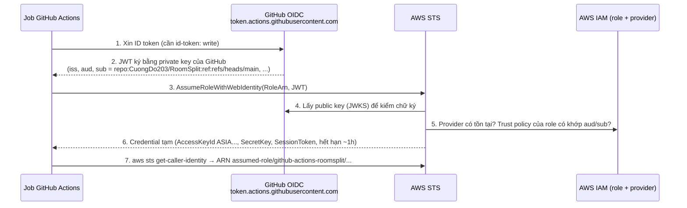

# GitHub Actions → AWS bằng OIDC (không lưu access key)

Tài liệu cho dev mới: giải thích OIDC là gì, vì sao an toàn hơn lưu access key trong GitHub Secrets, rồi hướng dẫn **từng bước** áp dụng cho repo `CuongDo203/RoomSplit`.

> ⚠️ Các lệnh `aws iam ...` trong bài **chưa được chạy** trên tài khoản nào. Tạo OIDC provider và role là thay đổi thật trên tài khoản AWS.
>
> Account ID trong bài là số giả `111122223333`. Thay bằng account ID thật, **không commit account ID thật vào docs**.
>
> Bài tập gốc đặt tên role là `github-actions-teamboard`. Trong RoomSplit dùng tên theo tiền tố dự án: **`github-actions-roomsplit`** (xem nguyên tắc đặt tên ở `docs/iam-notes.md` mục 10). Nếu bạn đang làm đúng bài tập gốc thì chỉ cần đổi tên, mọi bước giữ nguyên.

## Mục lục
1. [Mục tiêu và tiêu chí đạt](#1-mục-tiêu-và-tiêu-chí-đạt)
2. [Vấn đề: access key trong GitHub Secrets](#2-vấn-đề-access-key-trong-github-secrets)
3. [OIDC hoạt động thế nào](#3-oidc-hoạt-động-thế-nào)
4. [Ba mảnh ghép phía AWS và GitHub](#4-ba-mảnh-ghép-phía-aws-và-github)
5. [Trust policy: khóa đúng repo bằng `sub`](#5-trust-policy-khóa-đúng-repo-bằng-sub)
6. [Step by step cho RoomSplit](#6-step-by-step-cho-roomsplit)
7. [Kiểm tra theo tiêu chí đạt](#7-kiểm-tra-theo-tiêu-chí-đạt)
8. [Lỗi hay gặp](#8-lỗi-hay-gặp)
9. [Bước tiếp theo](#9-bước-tiếp-theo)
10. [Bảng tra cứu nhanh](#10-bảng-tra-cứu-nhanh)

---

## 1. Mục tiêu và tiêu chí đạt

Cần dựng:

1. **IAM OIDC identity provider** cho `token.actions.githubusercontent.com`.
2. **IAM role `github-actions-roomsplit`** với trust policy chỉ cho đúng repo (điều kiện trên claim `sub`).
3. **Workflow GitHub Actions** có `permissions: id-token: write`, dùng `aws-actions/configure-aws-credentials`, chạy `aws sts get-caller-identity`.

Đạt khi:

| # | Tiêu chí | Kiểm tra ở |
|---|---|---|
| 1 | Job in đúng ARN của role | [7.1](#71-job-in-đúng-arn-của-role) |
| 2 | GitHub Secrets không chứa AWS access key | [7.2](#72-github-secrets-không-chứa-access-key) |
| 3 | Trust policy không cho repo khác | [7.3](#73-trust-policy-không-cho-repo-khác) |
| 4 | Giải thích được vì sao OIDC an toàn hơn lưu key | [mục 2](#2-vấn-đề-access-key-trong-github-secrets), [7.4](#74-vì-sao-oidc-an-toàn-hơn) |

---

## 2. Vấn đề: access key trong GitHub Secrets

Cách "cổ điển" để CI gọi AWS:

1. Tạo IAM user `ci-bot`, sinh access key (`AKIA...` + secret key).
2. Dán vào GitHub Secrets: `AWS_ACCESS_KEY_ID`, `AWS_SECRET_ACCESS_KEY`.
3. Workflow đọc secret, gọi AWS.

Rủi ro:

| Rủi ro | Giải thích |
|---|---|
| **Key sống mãi** | Access key của IAM user không tự hết hạn. Lộ hôm nay, kẻ xấu dùng được đến khi có người phát hiện và xóa. |
| **Nhiều chỗ có thể lộ** | Log in nhầm (`echo`, debug), action bên thứ ba độc hại, máy của người có quyền admin repo, bản sao repo/secret cũ, file `.env` trên máy cá nhân. |
| **Dùng được ở bất cứ đâu** | Key không gắn với GitHub. Ai có key là gọi AWS được từ laptop bất kỳ. |
| **Phải tự xoay vòng** | Rotate key định kỳ là việc thủ công, hay bị quên. |
| **Khó truy vết** | CloudTrail chỉ thấy "user `ci-bot`", không biết repo nào, branch nào, lần chạy nào. |

Ý tưởng của OIDC: **không lưu gì bí mật cả**. Mỗi lần job chạy, GitHub chứng minh "tôi là job X của repo Y" bằng một token ký số; AWS kiểm chứng rồi phát credential **tạm thời** (mặc định 1 giờ).

---

## 3. OIDC hoạt động thế nào

**OIDC** (OpenID Connect) là chuẩn để một bên (Identity Provider, ở đây là GitHub) phát **ID token** dạng JWT nói "đây là ai", và bên kia (AWS) tin token đó vì kiểm được chữ ký.



Giải thích từng bước:

1. Job được cấp quyền xin token nhờ `permissions: id-token: write`. Không có dòng này, GitHub không phát token.
2. Token là **JWT** (3 phần base64: header, payload, chữ ký). Payload chứa các **claim**, quan trọng nhất:

   | Claim | Ví dụ | Ý nghĩa |
   |---|---|---|
   | `iss` | `https://token.actions.githubusercontent.com` | Ai phát token |
   | `aud` | `sts.amazonaws.com` | Token dành cho ai (action AWS tự đặt giá trị này) |
   | `sub` | `repo:CuongDo203/RoomSplit:ref:refs/heads/main` | **Ai đang chạy**: repo + ngữ cảnh (branch/tag/PR/environment) |
   | `repository`, `ref`, `workflow`, `actor`, `run_id` | | Thông tin chi tiết, hiện trong CloudTrail |
   | `exp` | vài phút | Token hết hạn rất nhanh |

3. Action `aws-actions/configure-aws-credentials` gửi token cho **STS** (Security Token Service) cùng ARN role muốn assume.
4. STS tải public key của GitHub để kiểm chữ ký: token giả hoặc bị sửa sẽ bị từ chối.
5. IAM kiểm: tài khoản có **OIDC provider** với URL khớp `iss` và client ID khớp `aud` không; **trust policy** của role có cho `sub` này không.
6. Đạt hết thì STS trả credential tạm (key bắt đầu bằng `ASIA`, kèm session token). Action ghi vào biến môi trường của job.
7. Các bước sau (`aws ...`, AWS SDK) dùng credential đó như bình thường.

> 💡 Liên hệ `docs/iam-notes.md` mục 2.3: role có **trust policy** (ai được assume) và **permission policy** (assume xong được làm gì). OIDC chỉ thay đổi phần "ai": thay vì một IAM user, principal là **một danh tính liên kết** (federated) từ GitHub.

---

## 4. Ba mảnh ghép phía AWS và GitHub

| Mảnh ghép | Ở đâu | Làm 1 lần hay mỗi repo | Vai trò |
|---|---|---|---|
| **OIDC identity provider** `token.actions.githubusercontent.com` | IAM của tài khoản AWS | 1 lần / tài khoản (dùng chung mọi repo) | Nói với AWS: "tin token do GitHub ký, audience `sts.amazonaws.com`" |
| **IAM role** `github-actions-roomsplit` | IAM | Mỗi repo / mỗi mục đích một role | Trust policy khóa đúng repo; permission policy quyết định CI được làm gì |
| **Workflow** | `.github/workflows/*.yml` trong repo | Mỗi repo | Xin token, assume role, gọi AWS |

Lưu ý:

- Provider chỉ là "cánh cửa tin GitHub". Có provider chưa đủ để vào được: **role** mới là chỗ quyết định repo nào được vào. Vì vậy mọi kiểm soát an ninh nằm ở trust policy.
- Thumbprint: trước đây phải nhập thumbprint chứng chỉ TLS của GitHub. Hiện AWS tự kiểm chứng chứng chỉ của `token.actions.githubusercontent.com` bằng CA tin cậy, nên thumbprint không còn quan trọng (Console tự điền, CLI cho bỏ trống ở bản mới).
- ARN của role **không phải bí mật**. Lưu trong GitHub **Variables** (`vars.AWS_ROLE_ARN`) cho dễ đổi, không cần Secrets.

---

## 5. Trust policy: khóa đúng repo bằng `sub`

Đây là phần quan trọng nhất. Trust policy cho RoomSplit:

```json
{
  "Version": "2012-10-17",
  "Statement": [
    {
      "Sid": "GitHubActionsRoomSplitOnly",
      "Effect": "Allow",
      "Principal": {
        "Federated": "arn:aws:iam::111122223333:oidc-provider/token.actions.githubusercontent.com"
      },
      "Action": "sts:AssumeRoleWithWebIdentity",
      "Condition": {
        "StringEquals": {
          "token.actions.githubusercontent.com:aud": "sts.amazonaws.com"
        },
        "StringLike": {
          "token.actions.githubusercontent.com:sub": "repo:CuongDo203/RoomSplit:*"
        }
      }
    }
  ]
}
```

Đọc từng dòng:

| Phần | Ý nghĩa |
|---|---|
| `Principal.Federated` | Chỉ token đến từ OIDC provider GitHub **trong tài khoản này** |
| `Action: sts:AssumeRoleWithWebIdentity` | Kiểu assume dành cho token OIDC (khác `sts:AssumeRole` của IAM user) |
| `aud = sts.amazonaws.com` | Token phải được phát cho AWS STS, không phải cho dịch vụ khác |
| `sub` like `repo:CuongDo203/RoomSplit:*` | Chỉ repo `CuongDo203/RoomSplit`, mọi branch/PR/tag |

### 5.1 Vì sao điều kiện `sub` bắt buộc

**Mọi** repo trên GitHub (hàng triệu repo của người lạ) đều xin được token từ cùng issuer `token.actions.githubusercontent.com`, với cùng `aud = sts.amazonaws.com`. Nếu trust policy chỉ kiểm `aud`, **bất kỳ ai** biết ARN role của bạn (mà ARN không bí mật) đều viết được workflow trong repo của họ để assume role của bạn.

`sub` là claim duy nhất phân biệt "repo của tôi" với "repo của người khác", và GitHub ký nó nên không giả được. Thiếu `sub` = lỗ hổng nghiêm trọng (AWS hiện cảnh báo/từ chối tạo trust policy GitHub thiếu điều kiện `sub`).

### 5.2 Các dạng `sub` cần biết

| Ngữ cảnh chạy job | Giá trị `sub` |
|---|---|
| Push / dispatch trên branch | `repo:CuongDo203/RoomSplit:ref:refs/heads/main` |
| Tag | `repo:CuongDo203/RoomSplit:ref:refs/tags/v1.0.0` |
| Pull request | `repo:CuongDo203/RoomSplit:pull_request` |
| Job có `environment: production` | `repo:CuongDo203/RoomSplit:environment:production` (**thay** dạng `ref:`) |

Chọn mức chặt:

| Mức | Giá trị `sub` trong policy | Dùng khi |
|---|---|---|
| Cả repo | `repo:CuongDo203/RoomSplit:*` (`StringLike`) | Bài tập này, role chỉ đọc / quyền nhỏ |
| Một branch | `repo:CuongDo203/RoomSplit:ref:refs/heads/main` (`StringEquals`) | Role deploy: chỉ code đã merge vào `main` mới deploy được |
| Một environment | `repo:CuongDo203/RoomSplit:environment:production` | Deploy production cần reviewer duyệt (GitHub Environments) |

Khuyến nghị: bài này dùng **cả repo** (đơn giản, đủ tiêu chí "không cho repo khác"). Khi làm role deploy thật (ECR push, ECS update) thì tạo role riêng khóa theo branch `main` hoặc environment.

> ⚠️ Cạm bẫy wildcard: `repo:CuongDo203/*` cho **mọi repo** của tài khoản `CuongDo203`; `repo:CuongDo203/RoomSplit*` (thiếu dấu `:`) khớp cả repo `RoomSplit-fork` hay `RoomSplitEvil` nếu ai đó tạo dưới cùng owner. Luôn giữ dấu `:` ngay sau tên repo.

---

## 6. Step by step cho RoomSplit

Tổng quan:

```
Bước 0  Chuẩn bị: account ID, quyền IAM, tên repo chính xác
Bước 1  Tạo OIDC provider            (AWS, 1 lần / tài khoản)
Bước 2  Tạo role github-actions-roomsplit + trust policy
Bước 3  (Tùy chọn) Gắn permission policy
Bước 4  Lưu ARN role vào GitHub Variables
Bước 5  Thêm workflow .github/workflows/aws-oidc-check.yml
Bước 6  Chạy workflow, đọc output
Bước 7  Kiểm tra tiêu chí đạt (mục 7)
```

### Bước 0. Chuẩn bị

1. **Quyền**: profile CLI `default` (`dev-readonly`) của lab **không có** quyền `iam:CreateOpenIDConnectProvider` / `iam:CreateRole`. Bước 1–3 làm bằng **root** (hoặc user admin) trên Console, hoặc chạy CLI với profile có quyền IAM.
2. **Account ID**: Console → góc phải trên → số 12 chữ số. Hoặc `aws sts get-caller-identity --query Account --output text`.
3. **Tên repo chính xác** (có phân biệt hoa thường trong điều kiện IAM):

   ```bash
   gh repo view --json nameWithOwner -q .nameWithOwner
   # CuongDo203/RoomSplit
   ```

### Bước 1. Tạo OIDC identity provider

**Console:** IAM → *Identity providers* → *Add provider*

| Trường | Giá trị |
|---|---|
| Provider type | OpenID Connect |
| Provider URL | `https://token.actions.githubusercontent.com` |
| Audience | `sts.amazonaws.com` |

→ *Add provider*. Nếu đã có provider này (từ lab khác) thì **dùng lại**, không tạo trùng (mỗi URL chỉ có 1 provider / tài khoản).

**CLI (tương đương):**

```bash
aws iam create-open-id-connect-provider \
  --url https://token.actions.githubusercontent.com \
  --client-id-list sts.amazonaws.com

# Kiểm tra
aws iam list-open-id-connect-providers
# arn:aws:iam::111122223333:oidc-provider/token.actions.githubusercontent.com
```

### Bước 2. Tạo role `github-actions-roomsplit`

**Console:** IAM → *Roles* → *Create role*

1. *Trusted entity type*: **Web identity**.
2. *Identity provider*: `token.actions.githubusercontent.com`; *Audience*: `sts.amazonaws.com`.
3. *GitHub organization*: `CuongDo203`; *GitHub repository*: `RoomSplit`; *GitHub branch*: để trống (= mọi branch, ra `repo:CuongDo203/RoomSplit:*`).
4. *Permissions*: bỏ qua (xem bước 3).
5. *Role name*: `github-actions-roomsplit`; *Description*: `GitHub Actions OIDC for CuongDo203/RoomSplit`.
6. Tạo xong, mở tab **Trust relationships** và so với JSON ở [mục 5](#5-trust-policy-khóa-đúng-repo-bằng-sub). Phải thấy cả `aud` và `sub`.

**CLI (tương đương):** lưu JSON ở mục 5 (đã thay account ID) thành `trust-github-roomsplit.json` **ngoài repo** (hoặc trong `artifacts/` đã git-ignore), rồi:

```bash
aws iam create-role \
  --role-name github-actions-roomsplit \
  --description "GitHub Actions OIDC for CuongDo203/RoomSplit" \
  --max-session-duration 3600 \
  --assume-role-policy-document file://trust-github-roomsplit.json

aws iam get-role --role-name github-actions-roomsplit --query Role.Arn --output text
# arn:aws:iam::111122223333:role/github-actions-roomsplit
```

### Bước 3. (Tùy chọn) Permission policy

`sts:GetCallerIdentity` **không cần quyền nào**: mọi danh tính đã xác thực đều gọi được. Vì vậy với bài tập này, role **không cần gắn policy nào**. Đây cũng là least privilege tốt nhất: dù token bị lạm dụng, role không làm được gì.

Khi cần CI làm việc thật (ví dụ đẩy image RoomSplit lên ECR ở `docs/aws-ecs-fargate-rds.md`), gắn policy hẹp theo ARN, ví dụ:

```json
{
  "Version": "2012-10-17",
  "Statement": [
    { "Effect": "Allow", "Action": "ecr:GetAuthorizationToken", "Resource": "*" },
    {
      "Effect": "Allow",
      "Action": [
        "ecr:BatchCheckLayerAvailability", "ecr:InitiateLayerUpload", "ecr:UploadLayerPart",
        "ecr:CompleteLayerUpload", "ecr:PutImage", "ecr:BatchGetImage"
      ],
      "Resource": "arn:aws:ecr:us-east-1:111122223333:repository/roomsplit-api"
    }
  ]
}
```

Khi đó nên khóa `sub` chặt hơn (branch `main`), xem [5.2](#52-các-dạng-sub-cần-biết).

### Bước 4. Lưu ARN role vào GitHub Variables

ARN không bí mật, nên dùng **Variables** (không phải Secrets):

- GitHub → repo `RoomSplit` → *Settings* → *Secrets and variables* → *Actions* → tab **Variables** → *New repository variable*: `AWS_ROLE_ARN` = `arn:aws:iam::111122223333:role/github-actions-roomsplit`.

Hoặc:

```bash
gh variable set AWS_ROLE_ARN --body "arn:aws:iam::111122223333:role/github-actions-roomsplit"
gh variable set AWS_REGION   --body "us-east-1"
```

### Bước 5. Thêm workflow

Tạo file riêng `.github/workflows/aws-oidc-check.yml` (không trộn vào `ci.yml`: CI build/test chạy cả trên PR từ fork, không cần AWS):

```yaml
name: AWS OIDC check

on:
  workflow_dispatch:          # chạy tay từ tab Actions
  push:
    branches: [main]
    paths:
      - .github/workflows/aws-oidc-check.yml

# Mặc định GITHUB_TOKEN chỉ được đọc code; thêm id-token để xin JWT OIDC.
permissions:
  id-token: write
  contents: read

jobs:
  whoami:
    runs-on: ubuntu-latest
    steps:
      - name: Configure AWS credentials (OIDC)
        uses: aws-actions/configure-aws-credentials@v4
        with:
          role-to-assume: ${{ vars.AWS_ROLE_ARN }}
          aws-region: ${{ vars.AWS_REGION || 'us-east-1' }}
          role-session-name: gh-${{ github.run_id }}-${{ github.run_attempt }}

      - name: Who am I
        run: aws sts get-caller-identity
```

Giải thích:

| Dòng | Vì sao |
|---|---|
| `permissions: id-token: write` | Bắt buộc để job xin được OIDC token. Khi khai báo `permissions`, mọi quyền khác về `none`, nên thêm lại `contents: read`. |
| `aws-actions/configure-aws-credentials@v4` | Action chính thức của AWS: xin token, gọi `AssumeRoleWithWebIdentity`, export `AWS_ACCESS_KEY_ID`/`AWS_SECRET_ACCESS_KEY`/`AWS_SESSION_TOKEN` tạm cho các bước sau. |
| `role-to-assume` | ARN role, lấy từ Variables. **Không có** `aws-access-key-id` / `aws-secret-access-key`: đó chính là điểm của bài. |
| `role-session-name` | Tên phiên, hiện trong ARN và CloudTrail → biết ngay lần chạy nào (`run_id`) đã gọi AWS. |
| Runner `ubuntu-latest` | Đã cài sẵn AWS CLI v2. |

> 💡 Bảo mật chuỗi cung ứng: production nên pin action theo **commit SHA** thay vì tag `@v4` (tag có thể bị dời). Dự án hiện đang dùng tag (`actions/checkout@v4` trong `ci.yml`), giữ cùng kiểu cho bài học.

Commit trên branch, merge vào `main` (hoặc chạy tay sau khi file có trên default branch: `workflow_dispatch` chỉ hiện nút *Run workflow* khi file nằm trên default branch).

### Bước 6. Chạy và đọc output

```bash
gh workflow run aws-oidc-check.yml --ref main
gh run watch                     # chọn lần chạy vừa tạo
gh run view --log | grep -A6 "Who am I"
```

Output mong đợi của bước *Who am I*:

```json
{
    "UserId": "AROAXXXXXXXXXXXXXXXXX:gh-1234567890-1",
    "Account": "111122223333",
    "Arn": "arn:aws:sts::111122223333:assumed-role/github-actions-roomsplit/gh-1234567890-1"
}
```

- `assumed-role/github-actions-roomsplit/...` = job đang mang danh tính role, không phải IAM user nào.
- Phần sau dấu `/` là `role-session-name`.
- `UserId` bắt đầu bằng `AROA` = role (IAM user bắt đầu bằng `AIDA`).

> GitHub tự che account ID trong log thành `***` nếu nó trùng một secret; ở đây không có secret nào nên thấy rõ. Đừng chụp màn hình log có account ID thật bỏ vào docs.

---

## 7. Kiểm tra theo tiêu chí đạt

### 7.1 Job in đúng ARN của role

`Arn` trong output phải có dạng:

```
arn:aws:sts::<account-id>:assumed-role/github-actions-roomsplit/<session-name>
```

Đối chiếu với ARN role (`arn:aws:iam::<account-id>:role/github-actions-roomsplit`): cùng account, cùng tên role. Lưu ý dạng khác nhau là bình thường: role là `iam::...:role/...`, phiên đang dùng là `sts::...:assumed-role/...`.

Kiểm tra thêm phía AWS (CloudTrail → *Event history* → Event name `AssumeRoleWithWebIdentity`): event có `userIdentity.type = WebIdentityUser`, `userName` chứa `repo:CuongDo203/RoomSplit:...`.

### 7.2 GitHub Secrets không chứa access key

```bash
gh secret list                 # repo secrets
gh secret list --env production   # nếu có environment (bỏ qua nếu chưa có)
gh api repos/CuongDo203/RoomSplit/actions/organization-secrets --jq '.secrets[].name'  # nếu repo thuộc org
```

Đạt khi **không** có `AWS_ACCESS_KEY_ID`, `AWS_SECRET_ACCESS_KEY` hay tên tương tự. Thêm hai kiểm tra:

```bash
# Workflow không tham chiếu key dài hạn
grep -rnE "aws-access-key-id|aws-secret-access-key|AWS_SECRET_ACCESS_KEY|AKIA" .github/
# Không có kết quả = đạt
```

Và phía AWS: nếu trước đây từng tạo IAM user cho CI, vào IAM → Users → user đó → *Security credentials* → **deactivate rồi delete** access key cũ, xóa secret cũ trên GitHub.

### 7.3 Trust policy không cho repo khác

1. **Đọc policy** (kiểm tĩnh):

   ```bash
   aws iam get-role --role-name github-actions-roomsplit \
     --query Role.AssumeRolePolicyDocument
   ```

   Checklist:
   - [ ] Có `token.actions.githubusercontent.com:aud` = `sts.amazonaws.com`
   - [ ] Có `token.actions.githubusercontent.com:sub`, bắt đầu bằng `repo:CuongDo203/RoomSplit:` (có dấu `:` sau tên repo)
   - [ ] Không có `*` ở phần owner/repo, không có statement thứ hai nới lỏng
   - [ ] `Principal` là `Federated` provider GitHub, không phải `"AWS": "*"`

2. **Thử thật** (kiểm động, nên làm một lần): tạo repo test tạm, ví dụ `CuongDo203/oidc-negative-test`, copy nguyên workflow ở bước 5, set cùng `AWS_ROLE_ARN`, chạy. Kết quả mong đợi: bước *Configure AWS credentials* **fail** với:

   ```
   Could not assume role with OIDC: Not authorized to perform sts:AssumeRoleWithWebIdentity
   ```

   Chạy xong thì xóa repo test (`gh repo delete CuongDo203/oidc-negative-test`).

### 7.4 Vì sao OIDC an toàn hơn

Tóm tắt để trình bày:

| | Access key trong Secrets | OIDC |
|---|---|---|
| Có bí mật lưu lâu dài? | Có, ở GitHub và thường ở máy người tạo | **Không**. Không có gì để lộ, không có gì để rotate |
| Thời hạn credential | Vô hạn đến khi xóa | Token GitHub vài phút; credential AWS mặc định 1 giờ, tự hết hạn |
| Dùng được ở đâu | Bất cứ đâu có key | Chỉ job GitHub Actions có token hợp lệ, **ký bởi GitHub**, đúng `sub` (repo/branch/environment) |
| Giới hạn phạm vi | Theo user, khó phân biệt repo/branch | Trust policy chọn chính xác repo, branch, environment |
| Truy vết | CloudTrail thấy "user ci-bot" | CloudTrail thấy repo, ref, session name chứa `run_id` |
| Thu hồi | Xóa key, cập nhật mọi nơi dùng | Sửa trust policy hoặc xóa role, hiệu lực ngay |

Một câu: **OIDC thay một bí mật dài hạn, dùng được ở mọi nơi, bằng credential ngắn hạn cấp theo từng lần chạy, chỉ cho đúng repo mà GitHub chứng nhận bằng chữ ký số.**

Giới hạn cần nói rõ (không thần thánh hóa): OIDC không chống được người **có quyền push** vào repo/branch được tin. Họ sửa workflow là dùng được role. Vì vậy vẫn cần least privilege trên role, branch protection cho `main`, và khóa role deploy theo branch/environment.

---

## 8. Lỗi hay gặp

| Triệu chứng | Nguyên nhân | Sửa |
|---|---|---|
| `Credentials could not be loaded` / `Unable to get ACTIONS_ID_TOKEN_REQUEST_URL env variable` | Thiếu `permissions: id-token: write` | Thêm ở cấp workflow hoặc job |
| `Not authorized to perform sts:AssumeRoleWithWebIdentity` | `sub` không khớp: sai hoa thường tên repo, job có `environment:` (sub đổi sang dạng `environment:`), chạy từ PR (sub = `pull_request`) mà policy khóa theo branch | Xem sub thật trong CloudTrail (event lỗi) rồi sửa policy |
| `No OpenIDConnect provider found in your account for https://token.actions.githubusercontent.com` | Chưa tạo provider, hoặc tạo ở tài khoản khác | Bước 1 |
| `Incorrect token audience` | Provider thiếu audience `sts.amazonaws.com` | Thêm audience vào provider |
| Workflow chạy trên PR từ fork không lấy được token | GitHub không cấp `id-token` cho PR từ fork (đúng thiết kế, để fork không lấy được quyền AWS) | Không chạy job AWS trên `pull_request` từ fork |
| `role-to-assume` rỗng | Quên tạo Variable, hoặc tạo nhầm thành Secret rồi đọc bằng `vars.` | `gh variable list` |
| Không thấy nút *Run workflow* | File workflow chưa nằm trên default branch `main` | Merge vào `main` trước |

---

## 9. Bước tiếp theo

Sau khi đạt bài này, có thể nối vào kế hoạch đã có (trả lời câu hỏi số 5 trong `docs/aws-ecs-fargate-rds.md`):

1. Tạo role thứ hai `github-actions-roomsplit-deploy`, sub khóa `ref:refs/heads/main` (hoặc `environment:production`), permission policy chỉ cho push ECR repository `roomsplit-api` (bước 3).
2. Job build Docker image (Dockerfile hiện có), push lên ECR bằng credential OIDC, tag theo `git describe` như `docs/docker-multi-env.md`.
3. Sau đó mới tới `ecs:UpdateService` / `iam:PassRole` cho deploy ECS.

---

## 10. Bảng tra cứu nhanh

| Thứ | Giá trị cho RoomSplit |
|---|---|
| Provider URL | `https://token.actions.githubusercontent.com` |
| Audience | `sts.amazonaws.com` |
| Provider ARN | `arn:aws:iam::<account-id>:oidc-provider/token.actions.githubusercontent.com` |
| Role | `github-actions-roomsplit` |
| Trust action | `sts:AssumeRoleWithWebIdentity` |
| Điều kiện `sub` | `repo:CuongDo203/RoomSplit:*` |
| GitHub Variables | `AWS_ROLE_ARN`, `AWS_REGION` |
| Workflow | `.github/workflows/aws-oidc-check.yml` |
| Quyền workflow | `id-token: write`, `contents: read` |
| Kiểm tra | `aws sts get-caller-identity` → `arn:aws:sts::<account-id>:assumed-role/github-actions-roomsplit/...` |

Liên quan: `docs/iam-notes.md` (role, trust policy, least privilege), `docs/aws-ecs-fargate-rds.md` (CI/CD về sau).
