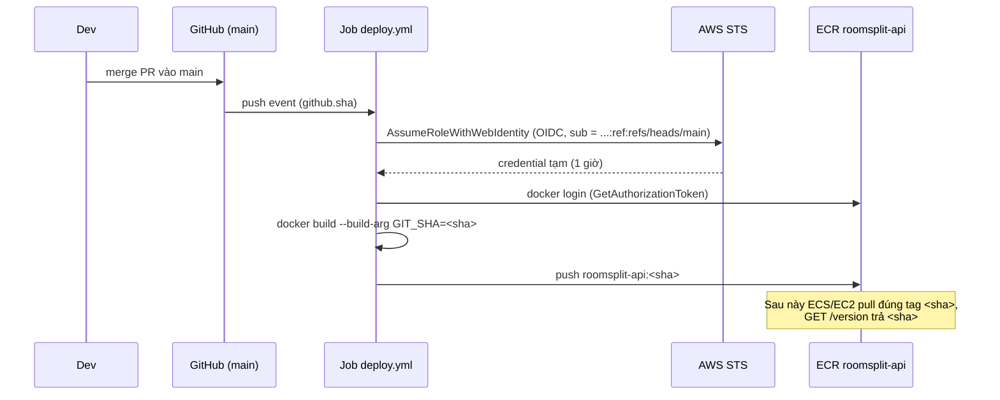

# Deploy workflow: build image, tag commit SHA, push ECR khi merge `main` + endpoint `/version`

Tiếp theo [aws-github-actions-oidc.md](aws-github-actions-oidc.md) (OIDC đã chạy được, role `github-actions-roomsplit`) và [aws-ecs-fargate-rds.md](aws-ecs-fargate-rds.md) (bước 1: "build image, tag theo commit, push ECR").

> Trạng thái: **đã chọn R2 + T1 + V1 + E1 + G2 + B1**. Phần code (bước 5–7) đã làm: [Dockerfile](../Dockerfile), [Common/BuildInfo.cs](../RoomSplit.Api/Common/BuildInfo.cs), `/version` trong [Program.cs](../RoomSplit.Api/Program.cs), [deploy.yml](../.github/workflows/deploy.yml). Phần AWS + GitHub (bước 1–4) làm tay bằng root; file JSON đã có sẵn trong `artifacts/` (`ecr-lifecycle.json`, `trust-ecr-push.json`, `policy-ecr-push.json`). Sau đó làm bước 8.

## Mục lục
1. [Yêu cầu](#1-yêu-cầu)
2. [Hiện trạng](#2-hiện-trạng)
3. [Luồng tổng thể](#3-luồng-tổng-thể)
4. [Các quyết định và phương án](#4-các-quyết-định-và-phương-án)
5. [Khuyến nghị](#5-khuyến-nghị)
6. [Hướng dẫn từng bước](#6-hướng-dẫn-từng-bước)
7. [Edge case](#7-edge-case)
8. [Lỗi hay gặp](#8-lỗi-hay-gặp)
9. [Ảnh hưởng tới code và tài liệu](#9-ảnh-hưởng-tới-code-và-tài-liệu)

---

## 1. Yêu cầu

1. File `.github/workflows/deploy.yml` chạy khi **merge vào `main`** (tức là có push lên `main`).
2. Build Docker image từ [Dockerfile](../Dockerfile).
3. Tag image bằng **commit SHA**.
4. Push lên **Amazon ECR**, xác thực bằng **OIDC** (không access key).
5. API có endpoint `/version` trả commit SHA mà image được build từ đó, để nhìn vào app đang chạy là biết chính xác code nào.

Ngoài phạm vi: deploy lên ECS/EC2 (bước sau), migration DB, rollback.

## 2. Hiện trạng

| Thứ | Tình trạng |
|---|---|
| OIDC provider `token.actions.githubusercontent.com` | Có (account `686255984671`) |
| Role `github-actions-roomsplit` | Có, trust `repo:CuongDo203@109535588/RoomSplit@1425829002:*` (mọi branch), **chưa có permission policy** nào |
| GitHub Variables | `AWS_ROLE_ARN` |
| ECR repository | **Chưa có** |
| `dev-readonly` | Không có quyền tạo ECR / IAM → các bước AWS ở mục 6 làm bằng root (hoặc user admin) |
| [ci.yml](../.github/workflows/ci.yml) | Chạy format + build + test trên push/PR `main`, `develop` |
| Dockerfile | Multi-stage, không biết commit nào; `.dockerignore` loại `.git/` nên trong lúc build không đọc được git |

## 3. Luồng tổng thể



## 4. Các quyết định và phương án

### 4.1 Role IAM dùng để push

| | R1. Dùng lại `github-actions-roomsplit` | R2. Role mới `github-actions-roomsplit-ecr-push`, trust khóa `main` |
|---|---|---|
| Cách làm | Gắn thêm policy push ECR vào role hiện có | Role riêng, `sub` = `repo:CuongDo203@109535588/RoomSplit@1425829002:ref:refs/heads/main`, chỉ có quyền push vào 1 repo ECR |
| Ưu | Ít bước | **Chỉ code đã vào `main` mới push được image**; branch `feature/x` sửa workflow cũng không lấy được quyền push. Đúng như khuyến nghị đã ghi ở [aws-github-actions-oidc.md](aws-github-actions-oidc.md) 5.2 |
| Nhược | Mọi branch, mọi PR nội bộ đều push được image vào ECR (có thể đè/lẫn image production) | Thêm 1 role + 1 variable |

### 4.2 Tag image

| | T1. Full SHA (40 ký tự) | T2. Short SHA (7 ký tự) | T3. SHA + `latest` |
|---|---|---|---|
| Ưu | Duy nhất tuyệt đối, khớp `github.sha`, khớp `git log` | Dễ đọc | Có tag "mới nhất" tiện pull tay |
| Nhược | Dài | Có thể trùng khi repo lớn (hiếm) | `latest` phải **mutable** → repo không bật được immutable tag; "latest" không cho biết code nào, dễ deploy nhầm |

Kèm theo: bật **tag immutability** trên repo ECR. Một tag SHA một khi đã push thì không ai đè được, nên tag là bằng chứng tin được về nội dung image.

### 4.3 Cách đưa SHA vào app (`/version` đọc từ đâu)

| | V1. Build arg → `AssemblyInformationalVersion` | V2. Build arg → biến môi trường `ENV APP_COMMIT_SHA` trong image | V3. Runtime env do người deploy truyền |
|---|---|---|---|
| Cách làm | Dockerfile: `dotnet publish -p:SourceRevisionId=$GIT_SHA`. SDK tự ghép thành `InformationalVersion = 1.0.0+<sha>`; code đọc bằng reflection | Dockerfile: `ARG GIT_SHA` + `ENV APP_COMMIT_SHA=$GIT_SHA`; code đọc `IConfiguration`/env | Task definition / compose đặt `APP_COMMIT_SHA` |
| Ưu | SHA **nằm trong DLL**, không bị env ghi đè nhầm; `dotnet run` ở máy dev cũng có SHA thật (SDK tự đọc từ `.git` qua SourceLink) | Đơn giản, dễ hiểu | Không sửa Dockerfile |
| Nhược | Phải hiểu cơ chế `SourceRevisionId` của SDK | Ai đó đặt `APP_COMMIT_SHA` lúc `docker run` là `/version` nói sai; `dotnet run` ở máy dev ra `unknown` | **Có thể lệch** với image thật (deploy image A nhưng ghi SHA B), mất ý nghĩa của `/version` |

Cả V1 và V2 đều nên thêm label OCI `org.opencontainers.image.revision=<sha>` (xem được bằng `docker inspect`, không cần chạy container).

### 4.4 Endpoint `/version`

| | E1. `app.MapGet("/version", ...)` cạnh `/health/*` | E2. `VersionController` tại `/api/v1/version` |
|---|---|---|
| Ưu | Endpoint hạ tầng, không thuộc API nghiệp vụ, không đổi khi API lên `v2`; cùng kiểu với `/health/live`; load balancer / script gọi đường cố định | Theo đúng kiểu controller của dự án |
| Nhược | Không phải controller (nhưng `/health/*` đã như vậy) | Gắn version API vào một endpoint không có version; `/api/v2` lại phải có bản riêng |

Response đề xuất (không lộ thông tin nhạy cảm):

```json
{ "commit": "3f2c1a9e...", "version": "1.0.0" }
```

### 4.5 Có chạy test trước khi push không

| | G1. `deploy.yml` độc lập, dựa vào CI của PR | G2. `deploy.yml` tự chạy lại build + test rồi mới build image | G3. `workflow_run` sau khi `CI` trên `main` xanh |
|---|---|---|---|
| Ưu | Đơn giản, nhanh | Không push image từ code chưa test, kể cả khi ai đó push thẳng `main` | Không lặp lại bước test |
| Nhược | Nếu push thẳng `main` (không qua PR) hoặc CI fail sau merge thì vẫn có image | Chạy test 2 lần trên `main` (CI + deploy), thêm khoảng 1–2 phút | Khó hiểu hơn: `workflow_run` chạy theo file workflow trên default branch, `github.sha` phải lấy từ `github.event.workflow_run.head_sha`, khó debug |

Lưu ý: hiện **chưa có test project** (CI `dotnet test` không làm gì) nên "test" thực chất mới là format + build Release.

### 4.6 Cách build

| | B1. `docker/build-push-action` + cache GitHub Actions | B2. `docker build` + `docker push` bằng lệnh |
|---|---|---|
| Ưu | Cache layer giữa các lần chạy (`type=gha`), lần sau restore NuGet gần như tức thì; khai báo gọn | Giống hệt lệnh chạy ở máy, dễ hiểu |
| Nhược | Thêm một action, phải biết buildx | Runner mới mỗi lần → không có cache, lần nào cũng build lại từ đầu (~2–3 phút) |

## 5. Khuyến nghị

**R2 + T1 + V1 + E1 + G2 + B1**, cộng tag immutability và lifecycle policy cho ECR.

- **R2**: image trên ECR là thứ sẽ chạy production. Khóa quyền push vào `main` là rào chắn rẻ nhất, và tách quyền "đọc thử" (role cũ) với quyền "phát hành".
- **T1 + immutable**: tag là SHA đầy đủ, không đè được → nhìn tag là biết chính xác code; rollback chỉ là deploy tag SHA cũ.
- **V1**: SHA nằm trong assembly nên `/version` không nói dối được và chạy được cả khi `dotnet run` ở máy dev.
- **E1**: `/version` là endpoint vận hành giống `/health/*`.
- **G2**: dự án chưa bật branch protection bắt buộc CI xanh; build + format thêm ~1 phút là đáng để không bao giờ có image từ code không build được.
- **B1**: tiết kiệm thời gian mỗi lần merge.

## 6. Hướng dẫn từng bước

> Giá trị cố định cho tài khoản này: account `686255984671`, region `us-east-1`, repo ECR `roomsplit-api`. Các lệnh AWS chạy bằng **root/admin** (không phải `dev-readonly`). File JSON tạm để **ngoài repo** hoặc trong `artifacts/` (đã git-ignore).

### Bước 1. Tạo ECR repository

```bash
aws ecr create-repository \
  --repository-name roomsplit-api \
  --image-tag-mutability IMMUTABLE \
  --image-scanning-configuration scanOnPush=true \
  --region us-east-1
```

Console tương đương: ECR → *Private registry* → *Create repository* → tên `roomsplit-api`, *Tag immutability* = **Immutable**, *Scan on push* = bật.

Kết quả cần ghi lại: `repositoryUri` = `686255984671.dkr.ecr.us-east-1.amazonaws.com/roomsplit-api`.

### Bước 2. Lifecycle policy (giữ chi phí trong free tier)

ECR free tier: 500 MB/tháng lưu trữ cho image private (tài khoản mới, 12 tháng). Một image RoomSplit nén khoảng 100 MB, nên chỉ giữ vài bản gần nhất.

`artifacts/ecr-lifecycle.json`:

```json
{
  "rules": [
    {
      "rulePriority": 1,
      "description": "Keep only the 5 most recent images",
      "selection": { "tagStatus": "any", "countType": "imageCountMoreThan", "countNumber": 5 },
      "action": { "type": "expire" }
    }
  ]
}
```

```bash
aws ecr put-lifecycle-policy --repository-name roomsplit-api \
  --lifecycle-policy-text file://artifacts/ecr-lifecycle.json --region us-east-1
```

> Khi đã deploy thật, đừng để lifecycle xóa mất image đang chạy hoặc bản dùng để rollback: tăng `countNumber` cho phù hợp.

### Bước 3. Tạo role `github-actions-roomsplit-ecr-push`

**3.1 Trust policy** `artifacts/trust-ecr-push.json` (khóa đúng branch `main`, dạng `sub` immutable của repo này, xem [aws-github-actions-oidc.md](aws-github-actions-oidc.md) 5.3):

```json
{
  "Version": "2012-10-17",
  "Statement": [
    {
      "Effect": "Allow",
      "Principal": {
        "Federated": "arn:aws:iam::686255984671:oidc-provider/token.actions.githubusercontent.com"
      },
      "Action": "sts:AssumeRoleWithWebIdentity",
      "Condition": {
        "StringEquals": {
          "token.actions.githubusercontent.com:aud": "sts.amazonaws.com",
          "token.actions.githubusercontent.com:sub": "repo:CuongDo203@109535588/RoomSplit@1425829002:ref:refs/heads/main"
        }
      }
    }
  ]
}
```

`StringEquals` (không phải `StringLike`) vì giá trị cố định, không có wildcard.

**3.2 Permission policy** `artifacts/policy-ecr-push.json` (chỉ push vào đúng 1 repo):

```json
{
  "Version": "2012-10-17",
  "Statement": [
    {
      "Sid": "EcrLogin",
      "Effect": "Allow",
      "Action": "ecr:GetAuthorizationToken",
      "Resource": "*"
    },
    {
      "Sid": "PushRoomSplitApi",
      "Effect": "Allow",
      "Action": [
        "ecr:BatchCheckLayerAvailability",
        "ecr:InitiateLayerUpload",
        "ecr:UploadLayerPart",
        "ecr:CompleteLayerUpload",
        "ecr:PutImage",
        "ecr:BatchGetImage",
        "ecr:DescribeImages"
      ],
      "Resource": "arn:aws:ecr:us-east-1:686255984671:repository/roomsplit-api"
    }
  ]
}
```

| Quyền | Vì sao cần |
|---|---|
| `GetAuthorizationToken` | `docker login` vào registry. API này không gắn với repo cụ thể nên `Resource` phải là `*` |
| `BatchCheckLayerAvailability`, `InitiateLayerUpload`, `UploadLayerPart`, `CompleteLayerUpload` | Đẩy từng layer (bỏ qua layer đã có) |
| `PutImage` | Ghi manifest + tag |
| `BatchGetImage` | Buildx đọc manifest đã có |
| `DescribeImages` | Bước kiểm tra "tag SHA đã tồn tại chưa" trong workflow (mục 7.1) |

Không có `ecr:BatchDeleteImage`, `DeleteRepository`: workflow không xóa được gì.

**3.3 Tạo role và gắn policy:**

```bash
aws iam create-role \
  --role-name github-actions-roomsplit-ecr-push \
  --description "GitHub Actions (main only) push to ECR roomsplit-api" \
  --assume-role-policy-document file://artifacts/trust-ecr-push.json

aws iam put-role-policy \
  --role-name github-actions-roomsplit-ecr-push \
  --policy-name ecr-push-roomsplit-api \
  --policy-document file://artifacts/policy-ecr-push.json
```

### Bước 4. GitHub Variables

```bash
gh variable set AWS_ECR_PUSH_ROLE_ARN --body "arn:aws:iam::686255984671:role/github-actions-roomsplit-ecr-push"
gh variable set AWS_REGION --body "us-east-1"
gh variable list
```

Variable chứ không phải Secret: ARN role không bí mật (bảo vệ nằm ở trust policy).

### Bước 5. Dockerfile: nhận SHA khi build

Sửa stage `build` (đặt `ARG` **sau** bước restore để không phá cache restore):

```dockerfile
COPY . .
# Commit SHA from CI (docker build --build-arg GIT_SHA=...). The SDK appends it to
# AssemblyInformationalVersion ("1.0.0+<sha>"), which GET /version reads.
ARG GIT_SHA=unknown
RUN dotnet publish RoomSplit.Api/RoomSplit.Api.csproj \
    -c Release --no-restore -o /app/publish /p:UseAppHost=false \
    /p:SourceRevisionId=${GIT_SHA}
```

Stage `final` thêm label:

```dockerfile
ARG GIT_SHA=unknown
LABEL org.opencontainers.image.revision=${GIT_SHA}
```

(`ARG` phải khai báo lại trong mỗi stage dùng nó.)

Vì sao cần truyền tay: `.dockerignore` loại `.git/`, nên trong container build SDK không tự đọc được commit như khi build ở máy.

### Bước 6. Endpoint `/version`

`RoomSplit.Api/Common/BuildInfo.cs`:

```csharp
using System.Reflection;

namespace RoomSplit.Api.Common;

/// <summary>Build metadata baked into the assembly (docs/deploy-ecr.md).</summary>
public static class BuildInfo
{
    private static readonly string InformationalVersion =
        typeof(BuildInfo).Assembly.GetCustomAttribute<AssemblyInformationalVersionAttribute>()?.InformationalVersion
        ?? "unknown";

    /// <summary>"1.0.0+3f2c1a9..." → "1.0.0".</summary>
    public static string Version { get; } = InformationalVersion.Split('+')[0];

    /// <summary>"1.0.0+3f2c1a9..." → "3f2c1a9..."; "unknown" when built without a commit.</summary>
    public static string Commit { get; } =
        InformationalVersion.Split('+') is [_, var sha] && sha.Length > 0 ? sha : "unknown";
}
```

`Program.cs`, cạnh `/health/*`:

```csharp
app.MapGet("/version", () => new { commit = BuildInfo.Commit, version = BuildInfo.Version });
```

Kiểm tra ở máy:

```bash
dotnet run --project RoomSplit.Api
curl http://localhost:<port>/version
# {"commit":"<sha của HEAD trên máy>","version":"1.0.0"}

docker build --build-arg GIT_SHA=$(git rev-parse HEAD) -t roomsplit-api:test .
docker run --rm -d -p 8090:8080 --name rs-version \
  -e Database__Host=x -e Database__Name=x -e Database__User=x \
  roomsplit-api:test
curl http://localhost:8090/version     # commit = git rev-parse HEAD
docker rm -f rs-version
```

> ⚠️ App dừng lúc start nếu thiếu `Database__Host/Name/User` (`ValidateOnStart`, [db-connection-config.md](db-connection-config.md)), nên khi thử image đơn lẻ phải truyền 3 biến trên. Giá trị giả cũng được vì `/version` không chạm DB (image không ở Development nên không migrate lúc start). Kiểm tra không cần chạy app: `docker inspect roomsplit-api:test --format '{{ index .Config.Labels "org.opencontainers.image.revision" }}'`.

### Bước 7. Tạo `.github/workflows/deploy.yml`

```yaml
name: Deploy (build & push ECR)

on:
  push:
    branches: [main]      # merge PR vào main = push lên main
  workflow_dispatch:      # chạy tay; chỉ thành công khi chọn branch main (trust policy)

permissions:
  id-token: write         # xin JWT OIDC
  contents: read

# Hai lần merge liên tiếp: chạy lần lượt, không hủy lần trước (mỗi SHA đều có image).
concurrency:
  group: deploy-ecr-main
  cancel-in-progress: false

env:
  ECR_REPOSITORY: roomsplit-api

jobs:
  verify:
    runs-on: ubuntu-latest
    steps:
      - uses: actions/checkout@v4
      - uses: actions/setup-dotnet@v4
        with:
          dotnet-version: 10.0.x
      - run: dotnet restore RoomSplit.slnx
      - run: dotnet format RoomSplit.slnx --no-restore --verify-no-changes
      - run: dotnet build RoomSplit.slnx --no-restore -c Release
      - run: dotnet test RoomSplit.slnx --no-build -c Release

  build-push:
    needs: verify
    runs-on: ubuntu-latest
    steps:
      - uses: actions/checkout@v4

      - name: Configure AWS credentials (OIDC)
        uses: aws-actions/configure-aws-credentials@v4
        with:
          role-to-assume: ${{ vars.AWS_ECR_PUSH_ROLE_ARN }}
          aws-region: ${{ vars.AWS_REGION || 'us-east-1' }}
          role-session-name: gh-deploy-${{ github.run_id }}-${{ github.run_attempt }}

      - name: Login to ECR
        id: ecr
        uses: aws-actions/amazon-ecr-login@v2

      # Tag immutable: re-run cùng SHA sẽ bị ECR từ chối, nên bỏ qua nếu đã có.
      - name: Skip if image already exists
        id: exists
        run: |
          if aws ecr describe-images --repository-name "$ECR_REPOSITORY" \
               --image-ids imageTag="$GITHUB_SHA" >/dev/null 2>&1; then
            echo "found=true" >> "$GITHUB_OUTPUT"
            echo "::notice::Image $ECR_REPOSITORY:$GITHUB_SHA already in ECR, skipping build."
          else
            echo "found=false" >> "$GITHUB_OUTPUT"
          fi

      - uses: docker/setup-buildx-action@v3
        if: steps.exists.outputs.found == 'false'

      - name: Build and push
        if: steps.exists.outputs.found == 'false'
        uses: docker/build-push-action@v6
        with:
          context: .
          push: true
          tags: ${{ steps.ecr.outputs.registry }}/${{ env.ECR_REPOSITORY }}:${{ github.sha }}
          build-args: GIT_SHA=${{ github.sha }}
          labels: org.opencontainers.image.revision=${{ github.sha }}
          cache-from: type=gha
          cache-to: type=gha,mode=max
          # Không đẩy attestation manifest: ECR hiện chúng thành artifact không tag, lẫn với image.
          provenance: false

      - name: Summary
        run: |
          echo "### Image" >> "$GITHUB_STEP_SUMMARY"
          echo "\`${{ steps.ecr.outputs.registry }}/${{ env.ECR_REPOSITORY }}:${{ github.sha }}\`" >> "$GITHUB_STEP_SUMMARY"
```

Giải thích các điểm chính:

| Dòng | Ý nghĩa |
|---|---|
| `on.push.branches: [main]` | GitHub không có sự kiện "merge"; merge PR tạo commit trên `main` = sự kiện `push` |
| `permissions.id-token: write` | Thiếu thì không xin được token OIDC |
| `needs: verify` | Code không build/format được thì không có image |
| `amazon-ecr-login` | Gọi `GetAuthorizationToken`, `docker login` vào registry; output `registry` = `686255984671.dkr.ecr.us-east-1.amazonaws.com` |
| `github.sha` | SHA đầy đủ của commit trên `main` vừa được push |
| `cache-from/to: type=gha` | Lưu layer vào cache của GitHub Actions; lần sau không phải restore NuGet lại |

### Bước 8. Đưa lên `main` và kiểm tra

1. Commit trên `develop`, mở PR `develop` → `main`, merge.
2. Theo dõi: `gh run watch` (hoặc tab *Actions*), workflow *Deploy (build & push ECR)*.
3. Kiểm tra ECR:

   ```bash
   aws ecr describe-images --repository-name roomsplit-api --region us-east-1 \
     --query 'sort_by(imageDetails,&imagePushedAt)[-1].{tags:imageTags,pushed:imagePushedAt,sizeMB:imageSizeInBytes}'
   git rev-parse origin/main    # phải trùng tag
   ```

4. Pull về chạy thử, gọi `/version`:

   ```bash
   aws ecr get-login-password --region us-east-1 | docker login --username AWS --password-stdin 686255984671.dkr.ecr.us-east-1.amazonaws.com
   SHA=$(git rev-parse origin/main)
   docker run --rm -d -p 8090:8080 --name rs-ecr \
     -e Database__Host=x -e Database__Name=x -e Database__User=x \
     686255984671.dkr.ecr.us-east-1.amazonaws.com/roomsplit-api:$SHA
   curl http://localhost:8090/version   # commit phải = $SHA
   docker rm -f rs-ecr
   ```

   (`dev-readonly` không có quyền ECR, nên pull bằng user có quyền, hoặc chỉ kiểm tra bằng `describe-images`.)

5. **Kiểm tra âm**: chạy tay workflow (*Run workflow*) chọn branch `develop`. Kỳ vọng: bước *Configure AWS credentials* lỗi `Not authorized to perform sts:AssumeRoleWithWebIdentity`, vì role chỉ tin `ref:refs/heads/main`.

## 7. Edge case

### 7.1 Re-run job cùng commit
Tag immutable → push lần 2 bị `ImageTagAlreadyExistsException`. Bước *Skip if image already exists* bỏ qua build. Đúng ý: cùng SHA thì cùng image, không build lại một bản khác.

### 7.2 Hai PR merge sát nhau
`concurrency` cho chạy lần lượt; mỗi SHA một image. Không dùng `cancel-in-progress: true` vì sẽ có commit trên `main` không có image.

### 7.3 Merge commit vs squash
`github.sha` là commit **trên `main`** (merge commit hoặc squash commit), không phải commit trên branch PR. `/version` trả SHA này; tra bằng `git show <sha>` trên `main`.

### 7.4 Build ở máy dev
`dotnet run` không qua Docker: SDK tự lấy SHA của HEAD (SourceLink có sẵn trong SDK). Có thay đổi chưa commit thì SHA vẫn là HEAD, nên `/version` ở máy dev không đảm bảo "đúng code" (chỉ image CI mới đảm bảo).

### 7.5 `docker build` không truyền `GIT_SHA`
`/version` trả `"commit": "unknown"`. Compose staging/prod đang build image bằng tag `git describe` ([docker-multi-env.md](docker-multi-env.md)); muốn có SHA thì thêm `build.args.GIT_SHA` hoặc `--build-arg GIT_SHA=$(git rev-parse HEAD)` khi build tay.

### 7.6 Lộ thông tin qua `/version`
SHA và version không phải bí mật (repo public trên GitHub). Không thêm môi trường, hostname, connection string hay đường dẫn vào response.

### 7.7 Chi phí
ECR free tier 500 MB + lifecycle giữ 5 image ≈ 500 MB. Data transfer push từ GitHub vào ECR (vào AWS) miễn phí. GitHub Actions cache tối đa 10 GB/repo, tự xóa cache cũ.

### 7.8 Cảnh báo NuGet `NU1902` (MySqlConnector 2.4.0)
`dotnet build -c Release` có restore trong cùng lệnh sẽ coi cảnh báo này là lỗi. Job `verify` restore ở cấu hình mặc định rồi build `--no-restore` (giống `ci.yml`) nên có thể không bị chặn; Dockerfile cũng vậy. Nếu workflow fail ở đây thì cần xử lý gói trước (ghim bản MySqlConnector đã vá trong `Directory.Packages.props`), không phải lỗi của workflow.

## 8. Lỗi hay gặp

| Triệu chứng | Nguyên nhân | Sửa |
|---|---|---|
| `Not authorized to perform sts:AssumeRoleWithWebIdentity` | Chạy từ branch khác `main`; `sub` trong trust policy viết dạng tên (`repo:CuongDo203/RoomSplit:...`) thay vì dạng có `@id` | Chỉ chạy trên `main`; xem [aws-github-actions-oidc.md](aws-github-actions-oidc.md) 5.3 |
| `role-to-assume` rỗng / `Could not load credentials` | Chưa tạo `AWS_ECR_PUSH_ROLE_ARN` | Bước 4 |
| `not authorized to perform: ecr:GetAuthorizationToken` | Thiếu statement `EcrLogin` hoặc `Resource` không phải `*` | Bước 3.2 |
| `name unknown: The repository with name 'roomsplit-api' does not exist` | Chưa tạo repo, hoặc khác region | Bước 1, kiểm tra `AWS_REGION` |
| `tag invalid: The image tag '...' already exists ... cannot be overwritten because the repository is immutable` | Re-run mà không có bước skip | Bước 7, step *Skip if image already exists* |
| `/version` trả `unknown` | Build không truyền `GIT_SHA` | Bước 5, kiểm tra `build-args` |
| `denied: User ... is not authorized to perform: ecr:InitiateLayerUpload on resource ...` | ARN repo trong policy sai account/region/tên | Bước 3.2 |

## 9. Ảnh hưởng tới code và tài liệu

| File | Thay đổi |
|---|---|
| `.github/workflows/deploy.yml` | Mới |
| `Dockerfile` | `ARG GIT_SHA`, `/p:SourceRevisionId`, `LABEL org.opencontainers.image.revision` |
| `RoomSplit.Api/Common/BuildInfo.cs` | Mới |
| `RoomSplit.Api/Program.cs` | `app.MapGet("/version", ...)` |
| `docs/aws-ecs-fargate-rds.md` | Bước 8.1 (push ECR tay) trỏ sang doc này |
| `CLAUDE.md` | Ghi lại: deploy workflow, quy ước tag SHA, `/version` |
| AWS (làm tay) | ECR `roomsplit-api` (immutable, scan on push, lifecycle), role `github-actions-roomsplit-ecr-push` |
| GitHub | Variables `AWS_ECR_PUSH_ROLE_ARN`, `AWS_REGION` |

Role cũ `github-actions-roomsplit` giữ nguyên cho `aws-oidc-check.yml` (không có quyền gì ngoài `sts:GetCallerIdentity`).
